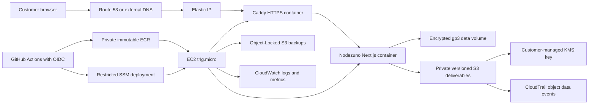
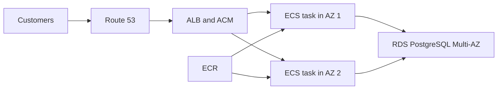

# Nodezuno AWS architecture

## Decision

Nodezuno starts with one carefully operated server, not a miniature enterprise
platform. This is the minimum architecture that supports the current
single-writer SQLite application honestly and economically.

## Launch controls

| Concern | Implementation | Why it exists now |
| --- | --- | --- |
| Reproducibility | Terraform with remote S3 state and native lock file | Rebuild and review the environment without console drift |
| Human access | IAM Identity Center and Session Manager | Temporary credentials, no SSH key, no port 22 |
| Workload access | EC2 IAM role plus a persistent Docker metadata firewall | No long-lived AWS credentials on disk; only the dedicated web egress subnet can request the host role |
| Deployment access | Separate GitHub build and deploy OIDC roles | Exact repository, branch, and production environment trust |
| Release identity | ECR image digest | A release cannot change after approval |
| Host payload | Versioned bundle and atomic `host-current` symlink | Compose, Caddy, backup, metrics, and deploy logic change together |
| Supply chain | Locked dependencies, audit gate, ECR scan, SBOM, provenance | Reject known vulnerable or untraceable releases |
| Edge security | Caddy, automatic TLS, hardened container, readiness-aware upstream admission, public-origin check | Only ports 80 and 443 reach the host, and an unready app receives no new edge traffic |
| Secret storage | One SSM SecureString uploaded outside Terraform and split into owner-only role environments on the host | No secrets in source, user data, or Terraform state; outbound workers receive exact allowlisted values and cannot reach instance metadata |
| Data durability | Protected encrypted EBS plus verified S3 backups | Preserve the single SQLite writer without pretending it is distributed |
| Backup integrity | Online SQLite backup, manifest verification, checksummed upload | A copied file is not accepted as a backup without verification |
| Backup deletion resistance | S3 Object Lock and no runtime delete permission | Limit damage from mistakes or a compromised application |
| Customer deliverables | Private versioned S3 bucket, customer-managed KMS key, SHA-256 manifest checks, and version-pinned signed downloads | Release verified evidence without making an object public or trusting a mutable key |
| Deliverable audit | CloudTrail read and write data events for the `reviews/` object prefix | Preserve an AWS-side access record independent of the application audit table |
| Payment evidence | Two independent Ethereum providers, configuration-bound heartbeat, immutable anomaly cases and confirmations, and a fresh-session idempotent operator decision | Keep browser assertions and ad hoc database edits from becoming payment authority |
| Host recovery | Daily EBS snapshots | Secondary recovery path for the entire data volume |
| Visibility | CloudWatch logs, custom metrics, dashboard, alarms, SNS | Detect readiness, deployment failure, memory, disk, swap, CPU, stale backups, edge 5xx responses, notification failures and backlog, stale payment-verifier heartbeat, payment backlog, and manual-review claims |
| Audit | Multi-region CloudTrail management events and Access Analyzer | Trace AWS control changes and unintended resource access |
| Host patching | Weekly SSM patch association with controlled reboot review | Apply security fixes without surprise restarts |
| Cost control | Account-level AWS Budget | Detect accidental expensive resources early |

## Trust boundaries

The public network can reach only Caddy on ports 80 and 443. The application
port is exposed only on the private Docker network. Caddy receives no account,
email, OAuth, signing, or API-key secrets.

The host security group permits outbound TCP 80 and 443 only for package
updates, AWS APIs, email delivery, OAuth, and certificate operations. Any
future upstream that requires another public port needs an explicit reviewed
rule instead of inheriting unrestricted egress.

The host validates one exact SSM parameter and writes three root-only files.
The web process receives the complete application environment. The email
worker receives only its delivery, origin, review-link, and operator-mailbox
values. The payment worker receives only payment mode, legal gate, confirmation,
and Ethereum evidence-source values. Every application container runs as UID
1001, drops every Linux capability, uses a read-only root filesystem, and
writes only its SQLite data directory and bounded temporary memory.

The three process roles use fixed, non-overlapping Docker subnets. A fail-closed
`DOCKER-USER` rule allows IMDS only from the web-only egress subnet and drops metadata
traffic from Caddy, email, payment, and any unrecognized container. The rule is
applied during bootstrap, before every deployment, before `nodezuno.service`,
and after every Docker restart. The web process retains the host role only
because it signs narrowly scoped S3 deliverable operations. This is an explicit
single-host launch boundary; the ECS scale profile replaces it with separate
task roles.

The application role may create, inspect, tag, and read only review objects
under the deliverables bucket's `reviews/` prefix and may use only the dedicated
deliverables KMS key. The bucket blocks public access, enforces bucket-owner
control, TLS, SSE-KMS with the exact key, versioning, and the temporary upload
tag. An administrator first seals a filename, content type, byte length, and
SHA-256 checksum in SQLite. The browser then uploads directly with a ten-minute
presigned POST. The server accepts the object only after its size, checksum,
KMS key, metadata, version ID, and storage identity match that seal. Buyer
downloads are authorized by the review capability or bound account and use a
five-minute presigned GET pinned to that verified object version.

The backup container receives no network. It sees the live data directory as
read-only and the backup directory as writeable. The host uploads the verified
artifact. The EC2 role can write new objects but cannot read or delete backup
objects.

The GitHub build role can publish only to the Nodezuno ECR repository. The
GitHub deploy role can invoke only the generated Nodezuno SSM document on the
one tagged EC2 instance. The EC2 role cannot read Terraform state.

Each deployment stages one content-addressed host bundle, validates it, then
switches one symlink while holding the deployment lock. A separate shared
background-operation lock prevents scheduled SQLite backups and workers from
overlapping migration, release backup, admission, or automatic image rollback.
Worker unit files and timer states are snapshotted before activation. A release
is final only after web and edge readiness, the required off-host backup,
systemd ownership, one successful email pass, one successful payment pass, and
both one-minute timers are proven. Only the activator then records image markers
and publishes success. Any failure restores the previous bundle, application
image, role environments, image markers, and worker schedule. Successful
releases prune older application images and host bundles while retaining the
current and immediately previous versions. Separate alarms cover the root
filesystem and persistent data volume.

## Availability boundary

The launch profile has one host, one Availability Zone, one application
process, and one SQLite writer. It is suitable for a low-traffic company site
and early paid workflow where a documented 30-to-60-minute recovery process is
acceptable. It is not a high-availability architecture and must not advertise
an SLA.

An ALB would not fix the single host or single database. EKS would not fix
them either. Adding orchestration before replacing SQLite creates cost and
operational complexity without a second healthy target.

## Scale architecture

The next production architecture is ECS and PostgreSQL, not automatically
Kubernetes:

Prerequisites before this transition:

1. a PostgreSQL database adapter;
2. PostgreSQL-compatible migrations;
3. SQLite-to-PostgreSQL migration and reconciliation tooling;
4. concurrency and transaction tests;
5. two-replica load tests at twice expected peak;
6. a PostgreSQL backup and restore drill;
7. stateless application storage;
8. an approved higher monthly cost ceiling.

## Kubernetes position

The repository keeps hardened Kubernetes templates for portability and local
validation. They intentionally run one replica with `Recreate` because the
database is SQLite. They are not an availability solution.

Use EKS only when Nodezuno has several independently deployed services,
multiple engineers who need a shared platform, Kubernetes-specific operators
or scheduling needs, and a named platform owner for upgrades, policy, and
incidents. Standard EKS control-plane support alone is $0.10 per cluster-hour
before worker nodes, load balancers, storage, public IP addresses, and logs.

## Decisions not taken at launch

- No NAT Gateway because the host already has controlled public egress.
- No ALB because there is only one healthy target.
- No RDS because the application has no PostgreSQL adapter yet.
- No ECS because one host is simpler and less expensive at current traffic.
- No EKS because orchestration is not the current constraint.
- No WAF because it cannot attach directly to this origin and there is no
  measured attack profile yet.
- No Cognito migration because Better Auth already provides application-owned
  email, Google, EVM, and Solana identity with database-backed sessions.
- No customer-managed KMS key for EBS, database backups, Terraform state, or
  Parameter Store. A dedicated customer-managed KMS key is used only for
  customer deliverables because each released object must prove the exact
  encryption key and support narrowly scoped application access.
- No long-lived staging environment. Test images in CI and create temporary
  environments only when a release risk justifies them.

These are cost and correctness decisions, not permanent limitations.
